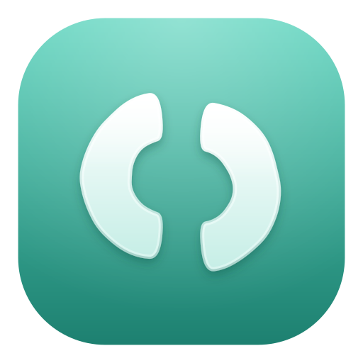

<p align="center">
  
</p>

<p align="center">
  
  
</p>

# Outcut AI

**Outcut AI** is a free, open-source video editor and screen recorder developed by [BuildWithDani](https://github.com/BuildWithDani).

It preserves the complete eligible recording and editing experience from [Recordly](https://github.com/webadderallorg/Recordly) — timeline editing, cursor polish, webcam overlays, backgrounds, annotations, extensions, and export — under Outcut AI branding.

**AI Director 2.0** is a planned flagship feature for guided, agent-assisted editing. It is **not implemented in this release**. Manual editing remains the foundation of Outcut AI.

Accepting PRs: https://github.com/BuildWithDani/Outcut

---

## What is Outcut AI?

Outcut AI is a desktop app for recording and editing screen captures with motion-driven presentation tools built in. Instead of sending raw footage elsewhere just to add zooms, cursor polish, or a styled background, Outcut AI handles that workflow in one place for free.

Outcut AI runs on (verified from upstream Recordly support):

- **macOS** 14.0+
- **Windows** 10 Build 19041+
- **Linux** on modern distros

Platform notes:

- **macOS** uses native ScreenCaptureKit-based capture helpers.
- **Windows** uses a native Windows Graphics Capture (WGC) helper on supported builds, with native WASAPI audio support.
- **Linux** records through Electron capture APIs. X11 uses a screen/window source list; Wayland opens the system picker when recording starts. Cursor hiding is not supported on Linux today.

---

## Available today

### Recording

- Record an entire display or a single app window
- Jump directly from recording into the editor
- Capture microphone audio and system audio
- Use native capture backends where supported
- Resume editing from saved `.recordly` project files
- Open existing recordings or existing project files from the app

### Timeline and editing

- Drag-and-drop timeline editing
- Trim unwanted sections
- Manual and automatic zoom regions
- Speed-up and slow-down regions
- Text, image, and figure annotations
- Extra audio regions
- Crop the recorded frame
- Save and reopen projects with editor state preserved

### Cursor, webcam, and framing

- Show/hide cursor overlay, size, style, and click effects
- Webcam bubble overlays with position, mirror, shadow, and roundness
- Backgrounds, padding, shadows, and framed compositions

### Export, settings, and extensions

- MP4 and GIF export
- Settings and keyboard shortcuts
- Community extension system and marketplace integration inherited from Recordly
- Project management on the home dashboard

### Planned (not shipped yet)

- **AI Director 2.0** — agent-assisted editing workflows on top of the manual editor
- Outcut Cloud and paid managed AI services are out of scope for this open desktop foundation

---

## Installation

Prebuilt installers will be published from https://github.com/BuildWithDani/Outcut/releases when releases are cut.

Until then, build from source (below).

---

## Development

Requirements:

- Node.js 20+ (22 verified on Windows for this rebrand)
- Rust toolchain (for native helpers)
- Platform build tools for Electron native modules

```bash
git clone https://github.com/BuildWithDani/Outcut.git
cd Outcut
npm install --legacy-peer-deps
npm run dev
```

Useful scripts:

```bash
npm run typecheck
npm test
npm run build:win    # Windows installer via electron-builder
npm run build:mac
npm run build:linux
```

Regenerate Outcut icons from the canonical SVG:

```bash
npm install --no-save sharp png2icons
node scripts/generate-outcut-icons.mjs
```

Canonical logo: `assets/branding/outcut-logo.svg`

---

## Contributing

See [CONTRIBUTING.md](./CONTRIBUTING.md). Issues: https://github.com/BuildWithDani/Outcut/issues

---

## Licensing

Outcut AI is licensed under the **AGPL 3.0**. See [LICENSE.md](./LICENSE.md).

Additional notices:

- [NOTICE.md](./NOTICE.md) — copyright layering and independently authored Outcut files
- [UPSTREAM.md](./UPSTREAM.md) — Recordly / OpenScreen provenance
- [THIRD_PARTY_NOTICES.md](./THIRD_PARTY_NOTICES.md) — third-party components
- [TRADEMARKS.md](./TRADEMARKS.md) — Outcut AI, Recordly, and OpenScreen marks
- [SECURITY.md](./SECURITY.md) — vulnerability reporting

---

## Credits

### Acknowledgements

Outcut AI is derived from **Recordly** by [webadderall](https://github.com/webadderallorg/Recordly).

Recordly originally started as a fork of [OpenScreen](https://github.com/siddharthvaddem/openscreen) by Siddharth Vaddem (2025).

BuildWithDani maintains Outcut AI branding, documentation, icon assets, and future independently authored features. BuildWithDani does **not** claim ownership of Recordly-derived or OpenScreen-derived code.

In-app **Credits** (home sidebar) repeats this attribution for end users.

### Maintainer

[BuildWithDani](https://github.com/BuildWithDani)
