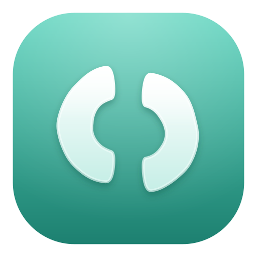

语言: [EN](README.md) | 简中

  

# Outcut AI

**Outcut AI** 是由 [BuildWithDani](https://github.com/BuildWithDani) 维护的免费开源桌面录屏与视频编辑应用：本地优先、AGPL 授权，不强制云账号。

完整安装、功能列表与开发说明请阅读英文版 [README.md](./README.md)。

## 当前已交付

- 屏幕 / 窗口录制（麦克风与系统音频视平台而定）
- 时间线编辑：缩放、变速、标注、背景、摄像头浮层、光标效果
- 本地导出 MP4 / GIF
- `.recordly` 工程文件兼容

## 路线图（尚未实现）

- **AI Director 2.0**：自带 Agent 的引导式剪辑层（当前仓库未实现）
- 独立运营的 Outcut Cloud（可选；桌面核心功能不依赖）

## 上游与许可

本项目基于 [Recordly](https://github.com/webadderallorg/Recordly)（AGPL-3.0），Recordly 最初来自 [OpenScreen](https://github.com/siddharthvaddem/openscreen)（MIT）。详见 [NOTICE.md](./NOTICE.md) 与 [UPSTREAM.md](./UPSTREAM.md)。BuildWithDani **不**声称拥有 Recordly / OpenScreen 继承代码的作者身份。

- 仓库：https://github.com/BuildWithDani/Outcut
- 许可：[LICENSE.md](./LICENSE.md)（AGPL-3.0）
- 贡献：[CONTRIBUTING.md](./CONTRIBUTING.md)
- 安全：[SECURITY.md](./SECURITY.md)
